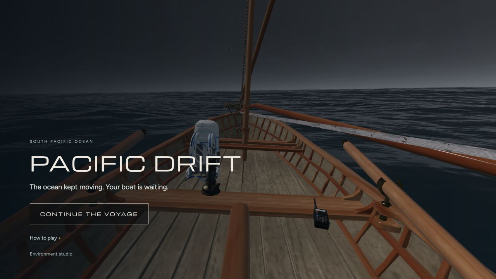
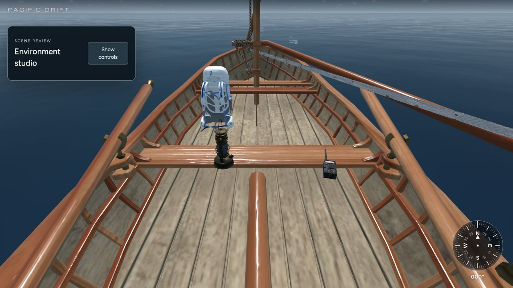
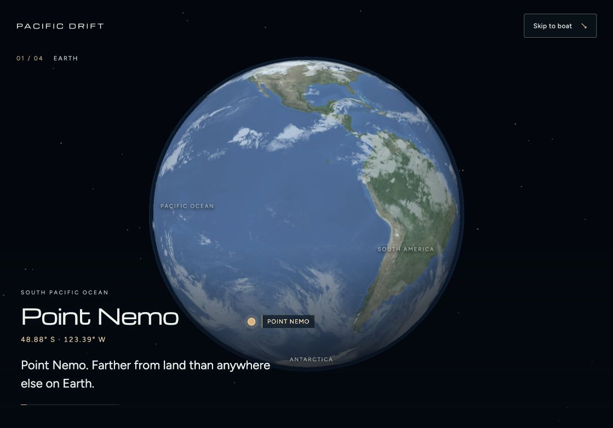
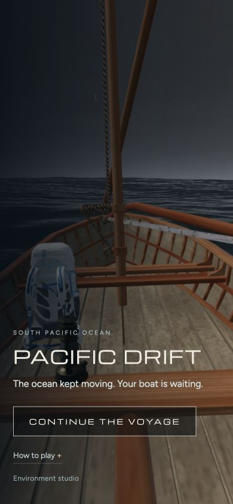

# Release review

The home screen now leads with one Begin/Continue action. Controls and Navigator settings are optional. The supplied backpack and radio are scaled in metres and placed on measured boat bench surfaces. Clicking the radio opens the existing radio controls.

The opening uses the supplied TERRA surface/cloud imagery and four timed story cards over a skippable 17-second descent. New, returning and Navigator voyages have appropriate text. Portrait globe framing is included.

Validation: 18 test scripts; production build; desktop/phone-width home and help; complete story playback; direct radio interaction; geometry-based scale/contact/rowlock clearance checks. Physical mobile-device frame rate was not measured.

## Clean home

## Gear placement

## Earth story

## Phone-width home

Merging the review branch into main runs the existing GitHub Pages deployment workflow. This review branch does not itself deploy.
